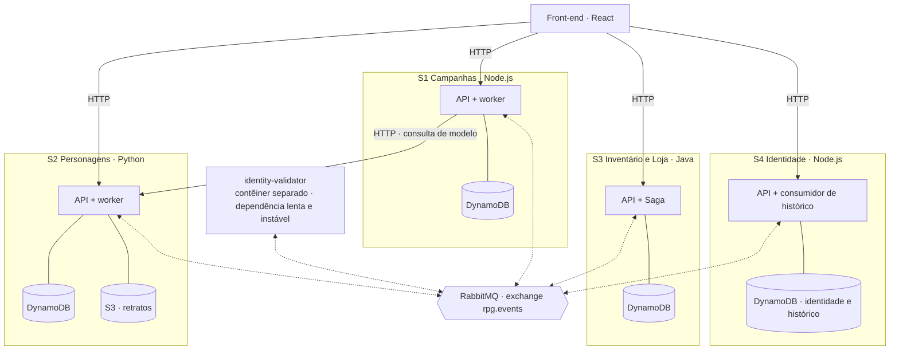

# RPG Nexus

Plataforma para mesas de RPG: o mestre cria a campanha e a loja, os jogadores entram por um código
de seis dígitos, montam as fichas e compram itens. Trabalho final de Sistemas Distribuídos (FURB):
quatro microsserviços em três linguagens, falando por eventos no RabbitMQ e usando DynamoDB e S3
emulados pelo MiniStack.

| Serviço | Linguagem | Responsável | O que faz |
| --- | --- | --- | --- |
| [S1 Campanhas](services/campaigns/README.md) | TypeScript (Node.js) | Lucas | Campanhas, participantes, código de entrada, modelo de ficha da campanha, atividade |
| [S2 Personagens](services/characters/README.md) | Python | Ana | Fichas, modelos, retratos no S3, mochila e saldo (débito e estorno) |
| [S3 Inventário e Loja](services/inventory/README.md) | Java | Christian | Loja da campanha, estoque, Saga de compra, inventário |
| [S4 Identidade](services/identity/README.md) | TypeScript (Node.js) | Nicolle | Cadastro, login (JWT), histórico de ações e validador externo da compra |
| [Front-end](apps/frontend/README.md) | React + Vite | Grupo | Telas de todos os serviços |

## Tema e registro

### Texto-base para registrar o RPG Nexus

**Integrantes:** Lucas, Ana, Christian e Nicolle. **Serviços e linguagens:** S1 Campanhas em TypeScript/Node.js (Lucas); S2 Personagens em Python (Ana); S3 Inventário e Loja em Java (Christian); S4 Identidade em TypeScript/Node.js (Nicolle). **Infraestrutura:** MiniStack, que emula DynamoDB e S3 da AWS localmente, e RabbitMQ em contêiner.

O RPG Nexus permite que grupos organizem campanhas de RPG, criem personagens e comprem itens em uma loja compartilhada. Na compra, o S3 reserva uma unidade do estoque e solicita ao S2 a validação do personagem e a reserva de espaço na mochila. Depois, o S4 encaminha a validação por meio do `identity-validator`, uma dependência simulada como lenta e instável, e o S2 realiza o débito do saldo. Quando uma etapa falha ou expira, a Saga do S3 libera o estoque; o S2 libera o espaço reservado na mochila e, se o débito já ocorreu, processa o estorno. Esse fluxo forma a **transação distribuída com compensação** entre S3, S2 e S4. A **dependência instável** é o `identity-validator`, cuja latência e taxa de falha são configuráveis. Ao concluir uma compra, o S3 publica o evento lógico `item.acquired` pela outbox; S1, S2 e S4 consomem esse evento para atualizar a atividade da campanha, confirmar a mochila e registrar o histórico, respectivamente, demonstrando um **evento com vários interessados**.

## Arquitetura



As setas sólidas representam chamadas HTTP: do front-end às APIs e a consulta que o S1 faz ao S2 para validar um modelo de ficha. As setas pontilhadas representam eventos pelo RabbitMQ. O validador externo usa o broker, mas não acessa o banco da Identidade. DynamoDB e S3 são os serviços da AWS emulados pelo MiniStack num único contêiner; cada microsserviço mantém suas próprias tabelas. A integração entre serviços acontece principalmente por eventos, com a consulta HTTP de modelo feita pelo S1 ao S2. Todo evento usa o mesmo envelope (`messageId`, `correlationId`, `type`, `version`,
`occurredAt`, `payload`) e tem esquema em [`contracts/`](contracts/README.md). O Jaeger recebe os
traces (OpenTelemetry), mas foi omitido do diagrama de negócio.

**Por que estas escolhas** (resumo; a justificativa completa vai na apresentação):

- **RabbitMQ:** filas de retry e DLQ por consumidor, várias filas ligadas ao mesmo evento e painel
  para inspecionar mensagens, tudo num contêiner.
- **DynamoDB:** transações (`TransactWriteItems`) para gravar efeito, inbox e outbox juntos, e
  escrita condicional para não vender a mesma unidade duas vezes.
- **S3:** retratos dos personagens, enviados direto pelo navegador com URL assinada.
- **MiniStack:** as mesmas APIs da AWS rodando local, sem conta e sem custo.

## Fluxo principal: compra na loja

1. O jogador pede a compra no S3, que responde **202** com um `operationId` e reserva uma unidade do
   estoque com escrita condicional.
2. O S2 confere o personagem e reserva espaço na mochila (`character.validation.requested`).
3. O validador externo, lento e com falhas configuráveis, aprova ou recusa
   (`external.validation.requested`).
4. O S2 debita o saldo do personagem (`money.debit.requested`).
5. O S3 entrega o item e publica `item.acquired` e `shop.item.purchased`. **Vários interessados:**
   o S1 conta o item na atividade da campanha, o S2 confirma a mochila e o S4 grava o histórico.
6. **Compensação:** se um passo falha ou o prazo vence, a Saga devolve o estoque, publica
   `acquisition.cancelled` (o S2 libera a mochila) e, se o débito já aconteceu, pede o estorno.

## Como rodar

Pré-requisito: Docker Desktop (ou Docker Engine) com Compose v2. Na raiz:

```sh
cp .env.example .env
docker compose up --build
```

O contêiner `terraform` cria toda a infraestrutura antes dos serviços: tabelas DynamoDB, bucket S3
e exchange, filas e ligações do RabbitMQ. Rodar de novo não muda nada; um recurso apagado é
recriado. Depois disso, abra o front-end em [localhost:5173](http://localhost:5173).

| O quê | No host | Entre contêineres |
| --- | --- | --- |
| Front-end | [localhost:5173](http://localhost:5173) | — |
| S1 Campanhas | [localhost:3001](http://localhost:3001/health) | `http://campaigns:3001` |
| S4 Identidade | [localhost:3002](http://localhost:3002/health) | `http://identity:3002` |
| S2 Personagens | [localhost:8000/docs](http://localhost:8000/docs) | `http://characters:8000` |
| S3 Inventário e Loja | [localhost:8080](http://localhost:8080/health) | `http://inventory:8080` |
| RabbitMQ (painel, `dev`/`dev`) | [localhost:15672](http://localhost:15672) | `amqp://rabbitmq:5672` |
| MiniStack (DynamoDB e S3) | `http://localhost:4566` | `http://ministack:4566` |
| Jaeger (traces) | [localhost:16686](http://localhost:16686) | OTLP/HTTP em `http://jaeger:4318` |

| Comando | Efeito |
| --- | --- |
| `docker compose up --build --detach --wait` | Sobe tudo em segundo plano e espera ficar saudável. |
| `docker compose logs -f <serviço>` | Logs de um serviço ([um painel por serviço](docs/logs-por-servico.md)). |
| `docker compose up -d --scale characters-worker=3` | Três réplicas do consumidor do S2. |
| `docker compose --profile autoscale up -d` | Liga a [autoescala](infra/autoscaler/README.md) do consumidor do S2. |
| `docker compose down` | Para tudo e mantém os dados. |
| `docker compose down --volumes` | **Apaga os dados** (filas, tabelas, arquivos) e para tudo. |

Endpoints, credenciais, portas e nomes de filas vêm de variáveis de ambiente, comentadas em
[`.env.example`](.env.example) e no `.env.example` de cada serviço. Mudar uma porta no `.env` muda
só o endereço no host; entre contêineres o MiniStack continua em `http://ministack:4566`.

## Onde está cada requisito

| Requisito | Onde |
| --- | --- |
| R1 At-least-once com idempotência | Inbox gravada na mesma transação do efeito: S1 [`repositories/`](services/campaigns/src/repositories), S2 [`dynamodb_store.py`](services/characters/app/adapters/dynamodb_store.py), S3 [`DynamoSagaRepository.java`](services/inventory/src/main/java/br/furb/rpg/inventory/adapters/dynamodb/DynamoSagaRepository.java), S4 [`repositories/`](services/identity/src/repositories) |
| R2 Controle de concorrência | Reserva de estoque com escrita condicional em [`DynamoSagaRepository.java`](services/inventory/src/main/java/br/furb/rpg/inventory/adapters/dynamodb/DynamoSagaRepository.java) |
| R3 API assíncrona | `POST /acquisitions` responde 202; `GET /acquisitions/{id}` mostra o andamento ([`InventoryApi.java`](services/inventory/src/main/java/br/furb/rpg/inventory/api/InventoryApi.java)) |
| R4 Consumidores concorrentes | `characters-worker` e `campaigns-worker` no [`docker-compose.yml`](docker-compose.yml) |
| R5 Dependência instável | [`validator.ts`](services/identity/src/validator.ts): `VALIDATION_FAILURE_RATE`, `VALIDATION_MIN_DELAY_MS`, `VALIDATION_MAX_DELAY_MS` |
| R6 Reconexão | S1 [`connection.ts`](services/campaigns/src/messaging/connection.ts), S2 [`rabbitmq.py`](services/characters/app/messaging/rabbitmq.py), S3 Spring AMQP, S4 [`consumer.ts`](services/identity/src/messaging/consumer.ts) |
| Retry e DLQ | Filas `.retry` e `.dlq` de cada consumidor em [`infra/rabbitmq`](infra/rabbitmq/README.md) |
| Bônus: tracing | OpenTelemetry e Jaeger implementados em [S1](services/campaigns/src/tracing), [S2](services/characters/app/tracing.py) e [S3](services/inventory/src/main/java/br/furb/rpg/inventory/tracing); ainda falta instrumentar o S4 e o `identity-validator` para cobrir todos os serviços. |
| Bônus: infraestrutura como código | [`infra/terraform`](infra/terraform/README.md) |
| Bônus: autoescala | [`infra/autoscaler`](infra/autoscaler/README.md) |
| Bônus: CQRS | Modelo de leitura do S2 em [`dynamodb_read_model.py`](services/characters/app/adapters/dynamodb_read_model.py) |
| Bônus: versionamento de eventos | `CharacterValidationRequested` v1 e v2 em [`contracts/events`](contracts/events) e [`events.py`](services/characters/app/messaging/events.py) |

## Documentação

- [Contratos dos eventos](contracts/README.md): envelope, tipos, quem publica e quem consome.
- Infraestrutura: [Terraform](infra/terraform/README.md), [RabbitMQ](infra/rabbitmq/README.md),
  [MiniStack](infra/ministack/README.md), [autoescala](infra/autoscaler/README.md).
- [Instalar o Node.js](docs/instalacao-node.md), só para desenvolver fora do Docker.
- [Logs por serviço no terminal](docs/logs-por-servico.md).
