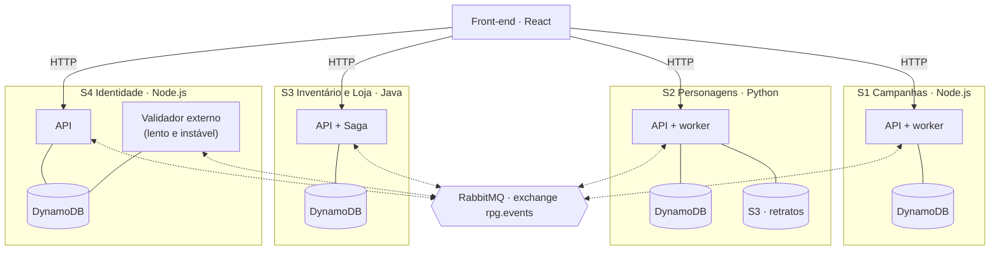

# RPG Nexus

Plataforma para mesas de RPG: o mestre cria a campanha e a loja, os jogadores entram por um código
de seis dígitos, montam as fichas e compram itens. Trabalho final de Sistemas Distribuídos (FURB):
quatro microsserviços em três linguagens, falando por eventos no RabbitMQ e usando DynamoDB e S3
emulados pelo MiniStack.

O registro do tema (fluxo principal e os três elementos pedidos), o diagrama da arquitetura e a
justificativa de cada serviço de nuvem estão em [`docs/registro-do-tema.md`](docs/registro-do-tema.md).

| Serviço | Linguagem | Responsável | O que faz |
| --- | --- | --- | --- |
| [S1 Campanhas](services/campaigns/README.md) | TypeScript (Node.js) | Lucas | Campanhas, participantes, código de entrada, modelo de ficha da campanha, atividade |
| [S2 Personagens](services/characters/README.md) | Python | Ana | Fichas, modelos, retratos no S3, mochila e saldo (débito e estorno) |
| [S3 Inventário e Loja](services/inventory/README.md) | Java | Christian | Loja da campanha, estoque, Saga de compra, inventário |
| [S4 Identidade](services/identity/README.md) | TypeScript (Node.js) | Nicolle | Cadastro, login (JWT), histórico de ações e validador externo da compra |
| [Front-end](apps/frontend/README.md) | React + Vite | Grupo | Telas de todos os serviços |

## Arquitetura



Setas do front são chamadas HTTP; as pontilhadas são eventos passando pelo RabbitMQ. Cada serviço tem uma instância MiniStack própria e uma rede privada de dados. O MiniStack de Personagens também fornece o S3 de retratos ao navegador. Cada serviço só alcança seu próprio endpoint; o que precisa saber dos outros chega por evento. Todo evento usa o mesmo envelope (`messageId`, `correlationId`, `type`, `version`,
`occurredAt`, `payload`) e tem esquema em [`contracts/`](contracts/README.md). O Jaeger recebe os
traces (OpenTelemetry) e não aparece no diagrama.

**Por que estas escolhas** (resumo; a justificativa completa vai na apresentação):

- **RabbitMQ:** filas de retry e DLQ por consumidor, várias filas ligadas ao mesmo evento e painel
  para inspecionar mensagens, tudo num contêiner.
- **DynamoDB:** transações (`TransactWriteItems`) para gravar efeito, inbox e outbox juntos, e
  escrita condicional para não vender a mesma unidade duas vezes.
- **S3:** retratos dos personagens, enviados direto pelo navegador com URL assinada.
- **MiniStack:** as mesmas APIs da AWS rodando local, sem conta e sem custo.

## Fluxo principal: compra na loja

1. O jogador pede a compra no S3, que responde **202** com um `operationId` e reserva uma unidade do
   estoque com escrita condicional.
2. O S2 confere o personagem e reserva espaço na mochila (`character.validation.requested`).
3. O validador externo, lento e com falhas configuráveis, aprova ou recusa
   (`external.validation.requested`).
4. O S2 debita o saldo do personagem (`money.debit.requested`).
5. O S3 entrega o item e publica `item.acquired` e `shop.item.purchased`. **Vários interessados:**
   o S1 conta o item na atividade da campanha, o S2 confirma a mochila e o S4 grava o histórico.
6. **Compensação:** se um passo falha ou o prazo vence, a Saga devolve o estoque, publica
   `acquisition.cancelled` (o S2 libera a mochila) e, se o débito já aconteceu, pede o estorno.

## Como rodar

Pré-requisitos: **Git** e **Docker** (Docker Desktop ou Docker Engine) com **Compose v2**. Não é
preciso instalar Node.js, Python, Java, Maven nem Terraform: cada serviço é compilado dentro da
própria imagem e o Terraform roda num contêiner. Reserve ao Docker pelo menos 4 GB de memória (6 a
8 GB é mais folgado) e uns 10 GB de disco.

```sh
git clone https://github.com/Lucas-Henschel/rpg-nexus.git
cd rpg-nexus
cp .env.example .env
docker compose up --build
```

O `.env` é opcional (sem ele valem os mesmos padrões do `.env.example`), mas é nele que se muda uma
porta ou um parâmetro. A primeira subida baixa as imagens e as dependências (npm, pip, Maven) e leva
alguns minutos; as seguintes usam o cache.

O contêiner `terraform` cria toda a infraestrutura antes dos serviços: tabelas DynamoDB, bucket S3
e exchange, filas e ligações do RabbitMQ. Rodar de novo não muda nada; um recurso apagado é
recriado. Depois disso, abra o front-end em [localhost:5173](http://localhost:5173) e siga o
[primeiro uso](#primeiro-uso-uma-compra-de-ponta-a-ponta).

| O quê | No host | Entre contêineres |
| --- | --- | --- |
| Front-end | [localhost:5173](http://localhost:5173) | — |
| S1 Campanhas | [localhost:3001](http://localhost:3001/health) | `http://campaigns:3001` |
| S4 Identidade | [localhost:3002](http://localhost:3002/health) | `http://identity:3002` |
| S2 Personagens | [localhost:8000/docs](http://localhost:8000/docs) | `http://characters:8000` |
| S3 Inventário e Loja | [localhost:8080](http://localhost:8080/health) | `http://inventory:8080` |
| RabbitMQ (painel, `dev`/`dev`) | [localhost:15672](http://localhost:15672) | `amqp://rabbitmq:5672` |
| MiniStack de Personagens (DynamoDB e S3) | `http://localhost:4566` | `http://ministack:4566` |
| MiniStacks de Campanhas, Inventário e Identidade | Não publicados no host | Endpoints exclusivos nas redes privadas de cada serviço |
| Jaeger (traces) | [localhost:16686](http://localhost:16686) | OTLP/HTTP em `http://jaeger:4318` |
| Tabelas de cada banco (`--profile db-admin`) | [Campanhas 8001](http://localhost:8001), [Personagens 8002](http://localhost:8002), [Inventário 8003](http://localhost:8003), [Identidade 8004](http://localhost:8004) | Cada tela só alcança o MiniStack do seu serviço |

| Comando | Efeito |
| --- | --- |
| `docker compose up --build --detach --wait` | Sobe tudo em segundo plano e espera ficar saudável. |
| `docker compose logs -f <serviço>` | Logs de um serviço ([um painel por serviço](docs/logs-por-servico.md)). |
| `docker compose up -d --scale characters-worker=3` | Três réplicas do consumidor do S2. |
| `docker compose --profile autoscale up -d` | Liga a autoescala do consumidor do S2. Para ver réplicas subindo é preciso encher a fila: [como demonstrar](infra/autoscaler/README.md). |
| `docker compose --profile db-admin up -d` | Abre as telas das tabelas (dynamodb-admin), uma por banco, nas portas 8001 a 8004. |
| `docker compose down` | Para tudo e mantém os dados. Com perfis ligados, repita o perfil: `docker compose --profile db-admin down`. |
| `docker compose down --volumes` | **Apaga os dados** (filas, tabelas, arquivos) e para tudo. |

Endpoints, credenciais, portas e nomes de filas vêm de variáveis de ambiente, comentadas em
[`.env.example`](.env.example) e no `.env.example` de cada serviço. Mudar uma porta no `.env` muda
só o endereço no host; os endpoints internos de cada serviço estão em [docker-compose.yml](docker-compose.yml).

## Primeiro uso: uma compra de ponta a ponta

O sistema sobe vazio. Para ver o fluxo principal pelo front-end:

1. Em [localhost:5173](http://localhost:5173), clique em **Criar conta** e entre. Esta conta será a do mestre.
2. Em **Campanhas**, crie uma campanha e anote o código de seis dígitos.
3. Abra a campanha. Em **Loja da campanha**, ative a loja e adicione um item com preço e estoque.
4. Numa janela anônima (outra sessão), crie a conta do jogador e use **Entrar com código** em **Campanhas**.
5. Ao abrir a campanha, o jogador escolhe ou cria o personagem. Na ficha do personagem (**Personagens**), dê a ele algum **Ouro**.
6. De volta à campanha, o jogador clica em **Comprar**. A tela mostra os passos da compra até **Item entregue**; o item aparece na mochila e o saldo diminui.

Para ver o que aconteceu por trás: no [Jaeger](http://localhost:16686), escolha o serviço `inventory` e abra o trace mais recente (ele passa por S3, S2, validador, S1 e S4); no [RabbitMQ](http://localhost:15672) (`dev`/`dev`), a aba **Queues** mostra as filas de cada consumidor e as DLQs.

Sem front-end, `bash scripts/requisitos/r3-api-assincrona.sh` faz uma compra completa sozinho.

## Scripts de demonstração

Com a pilha no ar, na raiz do repositório. Precisam só de **bash**, **curl** e **Docker**; no Windows, use o **Git Bash** (detalhes no README de cada pasta).

- [`scripts/requisitos`](scripts/requisitos/README.md): um script por requisito, R1 a R6 (por exemplo, `bash scripts/requisitos/r1-idempotencia.sh`).
- [`scripts/scenarios`](scripts/scenarios/README.md): os cenários de falha F1 a F8 (compensação,
  serviço que morre, mensagem duplicada, mensagem venenosa, corrida, broker fora, resposta tardia,
  escala), cada um com as verificações e o resultado `PASS`/`FAIL`.
- [`scripts/demo/popular-banco.sh`](scripts/demo/popular-banco.sh): dados de demonstração. Cria os
  usuários `mestre` e `jogador` (senha `rpg-nexus-demo`), uma campanha com loja, o personagem do
  jogador e cinco compras (quatro concluídas e uma compensada por falta de ouro). Bom para entrar no
  front e mostrar as tabelas com `--profile db-admin`.

## Onde está cada requisito

Para ver cada um funcionando, rode os [scripts de demonstração](#scripts-de-demonstração).

| Requisito | Onde |
| --- | --- |
| R1 At-least-once com idempotência | Inbox gravada na mesma transação do efeito: S1 [`repositories/`](services/campaigns/src/repositories), S2 [`dynamodb_store.py`](services/characters/app/adapters/dynamodb_store.py), S3 [`DynamoSagaRepository.java`](services/inventory/src/main/java/br/furb/rpg/inventory/adapters/dynamodb/DynamoSagaRepository.java), S4 [`repositories/`](services/identity/src/repositories) |
| R2 Controle de concorrência | Reserva de estoque com escrita condicional em [`DynamoSagaRepository.java`](services/inventory/src/main/java/br/furb/rpg/inventory/adapters/dynamodb/DynamoSagaRepository.java) |
| R3 API assíncrona | `POST /acquisitions` responde 202; `GET /acquisitions/{id}` mostra o andamento ([`InventoryApi.java`](services/inventory/src/main/java/br/furb/rpg/inventory/api/InventoryApi.java)) |
| R4 Consumidores concorrentes | `characters-worker` e `campaigns-worker` no [`docker-compose.yml`](docker-compose.yml) |
| R5 Dependência instável | [`validator.ts`](services/identity/src/validator.ts): `VALIDATION_FAILURE_RATE`, `VALIDATION_MIN_DELAY_MS`, `VALIDATION_MAX_DELAY_MS` |
| R6 Reconexão | S1 [`connection.ts`](services/campaigns/src/messaging/connection.ts), S2 [`rabbitmq.py`](services/characters/app/messaging/rabbitmq.py), S3 Spring AMQP, S4 [`consumer.ts`](services/identity/src/messaging/consumer.ts) |
| Retry e DLQ | Filas `.retry` e `.dlq` de cada consumidor em [`infra/rabbitmq`](infra/rabbitmq/README.md) |
| Bônus: tracing | OpenTelemetry e Jaeger nos quatro serviços: [S1](services/campaigns/src/tracing), [S2](services/characters/app/tracing.py), [S3](services/inventory/src/main/java/br/furb/rpg/inventory/tracing) e [S4](services/identity/src/tracing), incluindo o `identity-validator`. [Roteiro de compra e verificação do trace](scripts/requisitos/bonus-tracing.sh) |
| Bônus: infraestrutura como código | [`infra/terraform`](infra/terraform/README.md) |
| Bônus: autoescala | Quatro consumidores por tamanho de fila em [`infra/autoscaler`](infra/autoscaler/README.md) |
| Bônus: CQRS | Consultas em modelos de leitura separados das tabelas de escrita: atividade do S1 ([`activity-repository.ts`](services/campaigns/src/repositories/activity-repository.ts)), resumo dos personagens do S2 ([`dynamodb_read_model.py`](services/characters/app/adapters/dynamodb_read_model.py)), histórico da Saga do S3 ([`DynamoSagaRepository.java`](services/inventory/src/main/java/br/furb/rpg/inventory/adapters/dynamodb/DynamoSagaRepository.java)) e histórico da campanha do S4 ([`history-repository.ts`](services/identity/src/repositories/history-repository.ts)) |
| Bônus: versionamento de eventos | `CharacterValidationRequested` e `ShopItemPurchased` v1/v2 em [`contracts/events`](contracts/events) |

## Documentação

- [Registro do tema e arquitetura](docs/registro-do-tema.md): tema, integrantes, fluxo principal,
  diagrama e por que cada serviço de nuvem.
- [Fluxo da compra pela mensageria](docs/fluxo-mensageria.md): diagramas das filas, do caminho
  feliz, da compensação e de retry/DLQ.
- [Contratos dos eventos](contracts/README.md): envelope, tipos, quem publica e quem consome.
- Infraestrutura: [Terraform](infra/terraform/README.md), [RabbitMQ](infra/rabbitmq/README.md),
  [MiniStack](infra/ministack/README.md), [autoescala](infra/autoscaler/README.md).
- [Instalar o Node.js](docs/instalacao-node.md), só para desenvolver fora do Docker.
- [Logs por serviço no terminal](docs/logs-por-servico.md).
