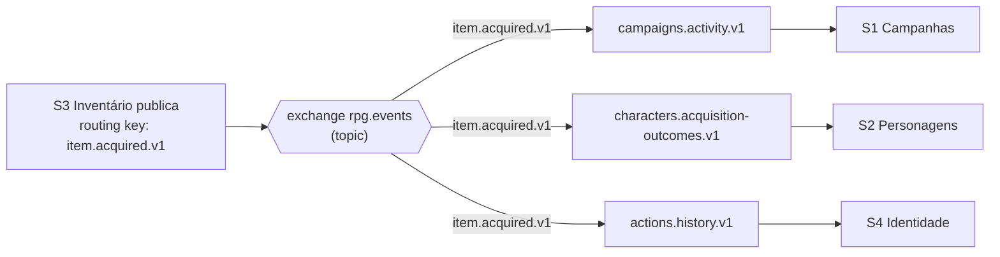
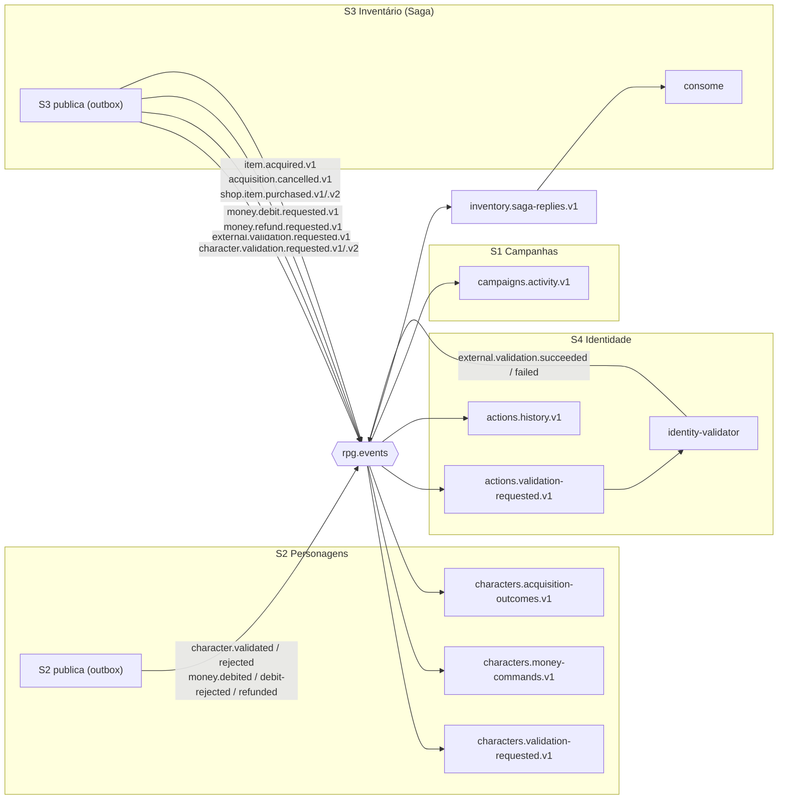
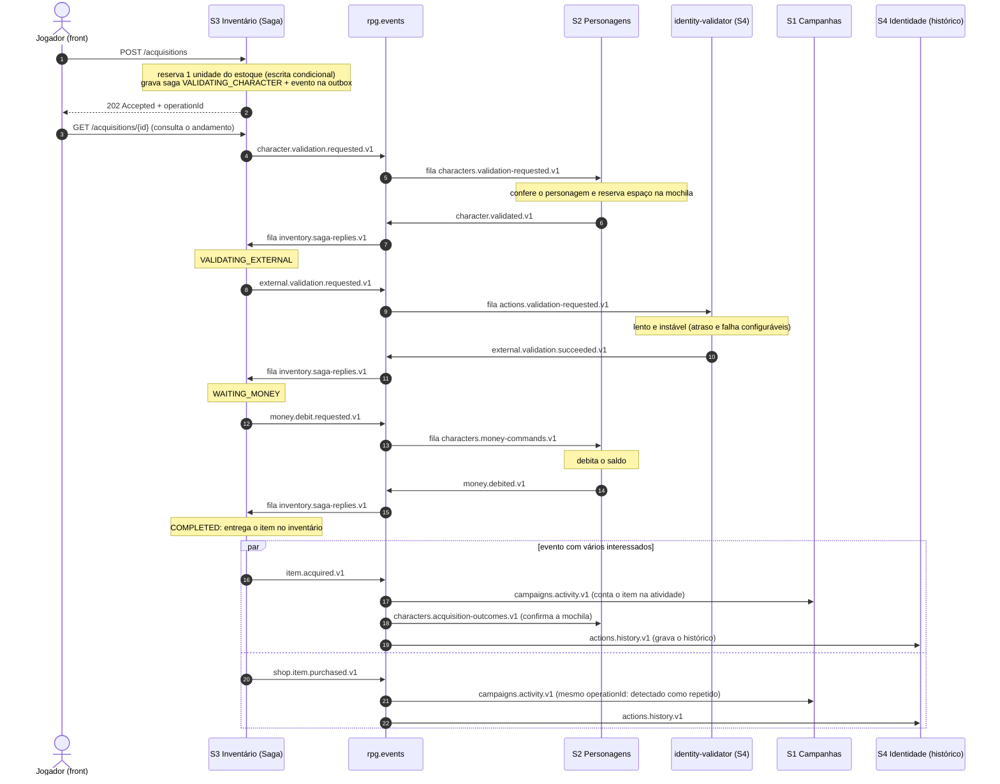
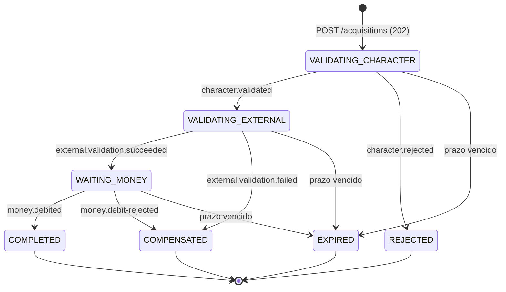
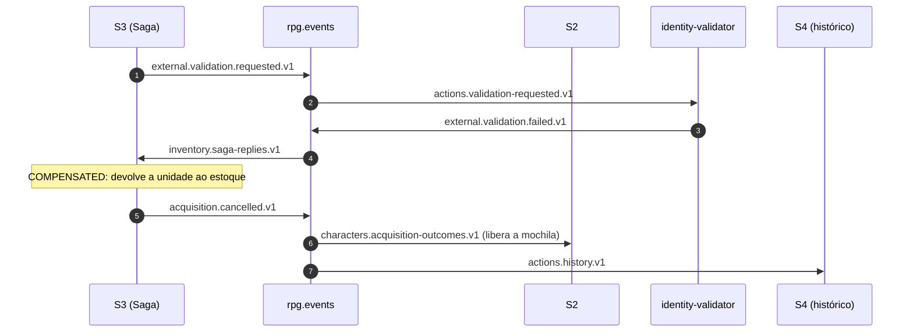
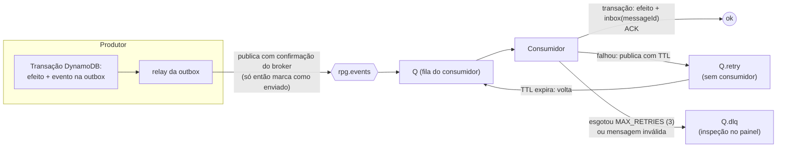
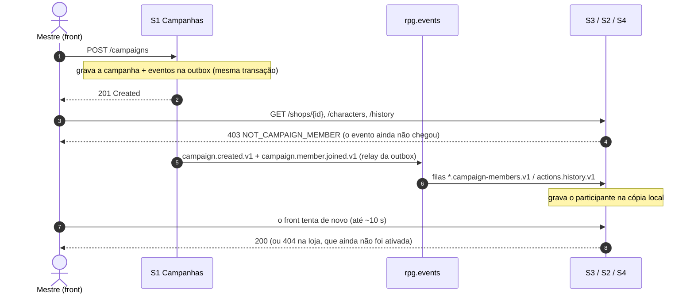

# RPG Nexus — fluxo principal pela mensageria

Fluxo: **compra de um item na loja**, visto pelas mensagens que passam pelo RabbitMQ. As filas e
ligações estão em [`infra/rabbitmq/definitions.json`](../infra/rabbitmq/definitions.json), os
eventos em [`contracts/`](../contracts/README.md) e a Saga do S3 em
[`SagaTransition.java`](../services/inventory/src/main/java/br/furb/rpg/inventory/domain/SagaTransition.java).

---

## 1. Ideia geral em uma frase

Há **um exchange só**, `rpg.events` (tipo *topic*). Cada serviço **publica** com uma *routing key*
(`item.acquired.v1`, por exemplo) e **consome** da **sua própria fila**, ligada ao exchange pelas
routing keys que interessam a ele. Quem publica não sabe quem consome.

É assim que aparece o **"evento com vários interessados"**: o S3 publica uma vez, três filas, três
consumidores independentes.

---

## 2. Mapa das filas da compra

Quem publica o quê, para qual fila, e quem consome. A **Saga fica no S3**, que conversa com os
outros serviços só por eventos: comandos saem do S3, respostas voltam para uma fila única do S3,
`inventory.saga-replies.v1`.

| Routing key | Publica | Fila (consumidor) |
| --- | --- | --- |
| `character.validation.requested.v1` e `.v2` | S3 | `characters.validation-requested.v1` (S2) |
| `character.validated.v1` / `character.rejected.v1` | S2 | `inventory.saga-replies.v1` (S3) |
| `external.validation.requested.v1` | S3 | `actions.validation-requested.v1` (identity-validator) |
| `external.validation.succeeded.v1` / `.failed.v1` | identity-validator | `inventory.saga-replies.v1` (S3) |
| `money.debit.requested.v1` / `money.refund.requested.v1` | S3 | `characters.money-commands.v1` (S2) |
| `money.debited.v1` / `money.debit-rejected.v1` / `money.refunded.v1` | S2 | `inventory.saga-replies.v1` (S3) |
| `item.acquired.v1` | S3 | `campaigns.activity.v1` (S1), `characters.acquisition-outcomes.v1` (S2), `actions.history.v1` (S4) |
| `shop.item.purchased.v1` e `.v2` | S3 | `campaigns.activity.v1` (S1), `actions.history.v1` (S4) |
| `acquisition.cancelled.v1` | S3 | `characters.acquisition-outcomes.v1` (S2), `actions.history.v1` (S4) |

---

## 3. Caminho feliz, passo a passo

O `correlationId` de todas essas mensagens é o `operationId` da compra; é ele que liga tudo (e é o
mesmo trace no Jaeger, porque o `traceparent` vai nos headers AMQP).

> O S1 recebe a compra duas vezes (`item.acquired` e `shop.item.purchased`), com `messageId`
> diferentes mas o mesmo `operationId`. A transação do S1 tem uma condição que recusa a segunda
> contagem; no Jaeger esse span aparece com `db.condition_failed = true`.

---

## 4. Quando algo dá errado: compensação

Estados da Saga:

O que a compensação publica:

| Situação | O S3 faz | Publica |
| --- | --- | --- |
| Personagem recusado, validação externa falhou, débito recusado | devolve a unidade ao estoque | `acquisition.cancelled.v1` → S2 libera a mochila, S4 grava no histórico |
| Prazo vencido (`SAGA_TIMEOUT_SECONDS`, 60 s) antes do débito | devolve o estoque | `acquisition.cancelled.v1` |
| Prazo vencido e o débito chega depois | devolve o estoque **e** pede estorno | `acquisition.cancelled.v1` + `money.refund.requested.v1` → S2 estorna e responde `money.refunded.v1` |
| Débito chega para uma saga já compensada/expirada | pede estorno | `money.refund.requested.v1` |

Exemplo: validador externo recusa.

---

## 5. Garantias em cada mensagem (o que acontece "por baixo")

- **Outbox:** o evento é gravado na mesma transação do efeito; se o serviço cair antes de publicar,
  o relay publica depois. Por isso a entrega é **pelo menos uma vez**.
- **Inbox:** o consumidor grava o `messageId` na mesma transação do efeito; a mesma mensagem
  entregue de novo é reconhecida e só confirmada (idempotência).
- **Retry e DLQ:** toda fila de consumo `Q` tem `Q.retry` (espera com TTL e volta para `Q`) e
  `Q.dlq` (o que esgotou as tentativas).
- **Consumidores concorrentes:** `characters-worker` e `campaigns-worker` podem ter várias réplicas
  na mesma fila; o RabbitMQ distribui as mensagens entre elas.

---

## 6. Consistência eventual: os 403 e 404 logo depois de criar uma campanha

Os serviços não consultam o banco do S1 para saber quem participa de uma campanha. Cada um mantém a
**própria cópia** dos participantes, alimentada pelos eventos `campaign.created.v1` e
`campaign.member.joined.v1`:

| Serviço | Fila | Usa a cópia para |
| --- | --- | --- |
| S2 Personagens | `characters.campaign-members.v1` | listar e criar fichas da campanha |
| S3 Inventário | `inventory.campaign-members.v1` | autorizar a loja e as compras |
| S4 Identidade | `actions.history.v1` | autorizar o histórico da campanha |

- **403 `NOT_CAMPAIGN_MEMBER`:** dura uma fração de segundo, o tempo do evento atravessar o
  RabbitMQ. Os três serviços usam o mesmo código, e o front repete a chamada por até ~10 s antes de
  mostrar erro (`apps/frontend/src/app/queryClient.ts`).
- **404 em `GET /shops/{id}`:** não é erro. A loja só existe depois que o mestre clica em **Ativar
  loja**; até lá a tela mostra "Esta campanha ainda não tem loja.".

É o custo de cada serviço ter os próprios dados: em troca, o S2, o S3 e o S4 continuam funcionando
mesmo com o S1 fora do ar.

---

## 7. Onde ver isso funcionando

- **RabbitMQ** ([localhost:15672](http://localhost:15672), `dev`/`dev`):
  - *Exchanges → rpg.events → Bindings*: as ligações da tabela da seção 2.
  - *Queues*: cada fila com `.retry` e `.dlq`; durante uma compra, as colunas *Incoming/Deliver*
    das filas acima se mexem.
- **Jaeger** ([localhost:16686](http://localhost:16686)): serviço `inventory`, trace
  `POST /acquisitions`. Os spans `... publish` e `... process` mostram cada passo do diagrama 3,
  na ordem, atravessando os cinco serviços.
- **Scripts:** `bash scripts/requisitos/r3-api-assincrona.sh` faz uma compra completa e mostra os
  estados da Saga; `bash scripts/scenarios/f1_compensacao.sh` mostra a compensação. Detalhes em
  [`scripts/requisitos`](../scripts/requisitos/README.md) e
  [`scripts/scenarios`](../scripts/scenarios/README.md).
