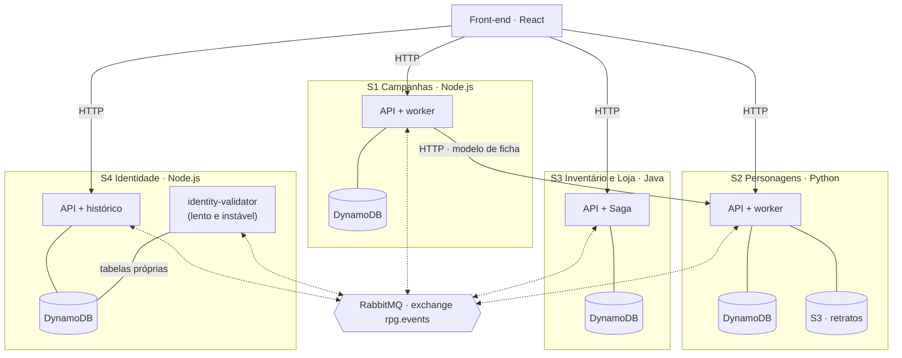

# RPG Nexus — registro do tema e arquitetura

## Registro do tema

**Tema:** RPG Nexus, uma plataforma para mesas de RPG. O mestre cria a campanha e a loja, os
jogadores entram por um código de seis dígitos, montam as fichas dos personagens e compram itens na
loja da campanha.

| Integrante | Serviço                                     | Linguagem             |
| ---------- | ------------------------------------------- | --------------------- |
| Lucas      | S1 Campanhas, infraestrutura e mensageria  | TypeScript (Node.js)  |
| Ana        | S2 Personagens                              | Python                |
| Christian  | S3 Inventário e Loja                        | Java                  |
| Nicolle    | S4 Identidade e validador externo           | TypeScript (Node.js)  |

Os quatro integrantes fizeram o front-end em conjunto (React + Vite).

**Nuvem:** MiniStack, a AWS emulada localmente em um contêiner, com os serviços **DynamoDB** (banco) e
**S3** (arquivos). A mensageria é o **RabbitMQ**, em contêiner próprio. O enunciado aceita broker em
contêiner quando as outras duas categorias são serviços gerenciados, que é o caso aqui.

### Fluxo principal: compra na loja

O jogador pede a compra de um item no S3 Inventário, que responde na hora com um identificador da
operação e reserva uma unidade do estoque. A partir daí, a Saga do S3 coordena os passos por eventos:

1. o S2 Personagens confere o personagem e reserva espaço na mochila;
2. o `identity-validator` (parte do S4, em contêiner próprio) faz a validação externa;
3. o S2 debita o saldo do personagem;
4. o S3 entrega o item e publica `item.acquired`.

Se um passo falha ou o prazo da compra vence, a Saga desfaz o que já foi feito. Ela devolve a
unidade ao estoque, publica `acquisition.cancelled` para o S2 liberar o espaço na mochila e, se o
débito já aconteceu, pede o estorno do valor.

**Onde estão os três elementos pedidos:**

| Elemento                                     | No RPG Nexus                                                                                                                                                                                                                                                                                         |
| -------------------------------------------- | ---------------------------------------------------------------------------------------------------------------------------------------------------------------------------------------------------------------------------------------------------------------------------------------------------- |
| **Transação distribuída com compensação**    | A compra atravessa S3, S2 e o validador do S4. A Saga fica no S3 ([`SagaTransition.java`](../services/inventory/src/main/java/br/furb/rpg/inventory/domain/SagaTransition.java)). A compensação devolve o estoque (S3), libera a mochila (S2) e estorna o débito (S2).                                |
| **Dependência lenta ou instável**            | O `identity-validator` ([`validator.ts`](../services/identity/src/validator.ts)). A latência e a taxa de falha vêm das variáveis `VALIDATION_MIN_DELAY_MS`, `VALIDATION_MAX_DELAY_MS` e `VALIDATION_FAILURE_RATE`.                                                                                  |
| **Evento com vários interessados**           | O S3 publica `item.acquired` uma vez. O S1 registra a atividade da campanha, o S2 confirma a reserva da mochila e o S4 grava o histórico de ações, cada um na sua fila. O mesmo vale para `campaign.member.joined`, do S1, consumido por S2, S3 e S4.                                                |

## Arquitetura

**Como ler o diagrama:**

- **Setas sólidas:** chamadas HTTP, do front-end às APIs, e a consulta que o S1 faz ao S2 ao
  escolher o modelo de ficha da campanha.
- **Setas pontilhadas:** eventos pelo RabbitMQ, sem detalhar filas.
- **Bancos e armazenamento:** cada serviço tem sua instância MiniStack, credenciais e rede privada de
  dados. O `identity-validator` compartilha a instância do S4, pois é um processo desse mesmo serviço.
  O S3 de retratos fica na instância do S2 Personagens e tem uma porta publicada para URLs pré-assinadas.

## Serviços de nuvem e por que cada um

| Categoria      | Escolha                        | Por que ele                                                                                                                                                                                                                                   | Por que não a alternativa                                                                                                                                                                                                     |
| -------------- | ------------------------------ | --------------------------------------------------------------------------------------------------------------------------------------------------------------------------------------------------------------------------------------------- | ----------------------------------------------------------------------------------------------------------------------------------------------------------------------------------------------------------------------------- |
| Mensageria     | RabbitMQ (contêiner)           | Uma exchange de tópicos entrega o mesmo evento a uma fila por interessado. Cada consumidor tem fila de retry (com espera) e DLQ próprias. As confirmações de publicação garantem que a outbox só marca o evento depois que o broker aceitou. O painel mostra filas e DLQ ao vivo | **SQS + SNS:** o mesmo resultado exige um tópico SNS com uma fila SQS assinada por consumidor, e o retry com espera fica mais limitado. **Kafka:** é um log particionado; retry e DLQ por mensagem não vêm prontos e a operação é mais pesada, sem ganho para o volume do projeto |
| Banco de dados | DynamoDB                       | `TransactWriteItems` grava o efeito, a inbox e a outbox numa transação só. A escrita condicional impede vender a mesma unidade duas vezes. Tabelas por serviço sem servidor para administrar, com TTL para limpar inbox e outbox | **RDS (Postgres/MySQL):** exigiria uma instância ou um schema por serviço, migrações e pool de conexões. Os acessos são todos por chave, sem junções, então o modelo relacional não traria vantagem |
| Armazenamento  | S3                             | Os retratos dos personagens vão direto do navegador para o bucket com URL assinada, sem passar pelo serviço                                                                                                                                 | **Guardar no DynamoDB:** limite de 400 KB por item, e a imagem passaria pela API. **Disco do contêiner:** some quando o contêiner é recriado e não é compartilhado entre réplicas                                               |
| Provedor       | MiniStack (AWS emulada)        | As mesmas APIs da AWS, sem conta nem custo, e o sistema inteiro sobe com um `docker compose up`. O código só muda o endpoint                                                                                                               | **AWS real:** custo e conta para cada integrante, e risco de recurso esquecido ligado. O Terraform do projeto ([`infra/terraform`](../infra/terraform/README.md)) serviria para a AWS real trocando só os endpoints                   |
