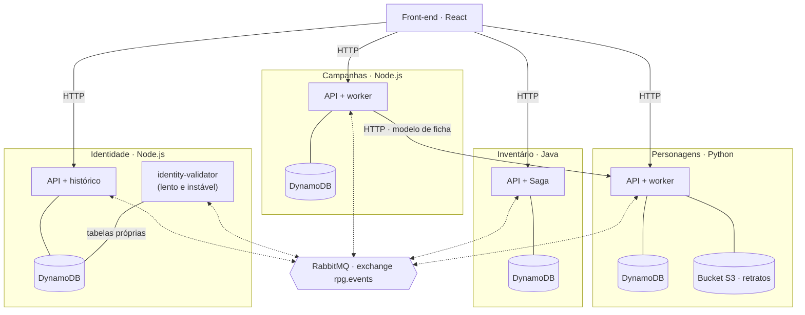

# RPG Nexus — registro do tema e arquitetura

## Registro do tema

**Nome do tema:** RPG Nexus, uma plataforma para mesas de RPG.

**Integrantes e linguagem de cada serviço:**

| Integrante | Serviço                           | Linguagem            |
| ---------- | --------------------------------- | -------------------- |
| Lucas      | Campanhas                         | TypeScript (Node.js) |
| Ana        | Personagens                       | Python               |
| Christian  | Inventário                        | Java                 |
| Nicolle    | Identidade e validador externo    | TypeScript (Node.js) |

**Provedor de nuvem:** MiniStack (AWS emulada localmente, em contêiner).

**Fluxo principal: comprar um item na loja.** O jogador pede a compra de um item. O serviço de
Inventário reserva o item no estoque e coordena os próximos passos: o serviço de Personagens
confere o personagem e reserva espaço na mochila, o validador externo do serviço de Identidade
aprova a compra e o serviço de Personagens desconta o ouro. No fim, o item vai para o inventário do
personagem e o aviso "item adquirido" é enviado para os outros serviços.

**Onde estão os três elementos pedidos:**

1. **Transação distribuída com compensação:** a compra passa pelos serviços de Inventário,
   Personagens e Identidade. Se um passo falha, a compra é desfeita: o item volta ao estoque, o espaço
   na mochila é liberado e, se o ouro já foi descontado, ele é devolvido.
2. **Dependência lenta ou instável:** o validador externo do serviço de Identidade simula um parceiro
   externo. O atraso e a chance de falha são configurados por variáveis de ambiente.
3. **Evento com vários interessados:** o aviso "item adquirido" é publicado uma vez pelo serviço de
   Inventário e recebido por três serviços: Campanhas mostra a compra na campanha, Personagens
   confirma a mochila e Identidade guarda no histórico.

## Arquitetura

**Como ler o diagrama:**

- **Setas sólidas:** chamadas HTTP, do front-end às APIs, e a consulta que Campanhas faz a
  Personagens ao escolher o modelo de ficha da campanha.
- **Setas pontilhadas:** eventos pelo RabbitMQ, sem detalhar filas.
- **Bancos e armazenamento:** cada serviço tem sua instância MiniStack, credenciais e rede privada de
  dados. O `identity-validator` compartilha a instância de Identidade, pois é um processo desse
  mesmo serviço. O bucket S3 de retratos fica na instância de Personagens e tem uma porta publicada
  para URLs pré-assinadas.
