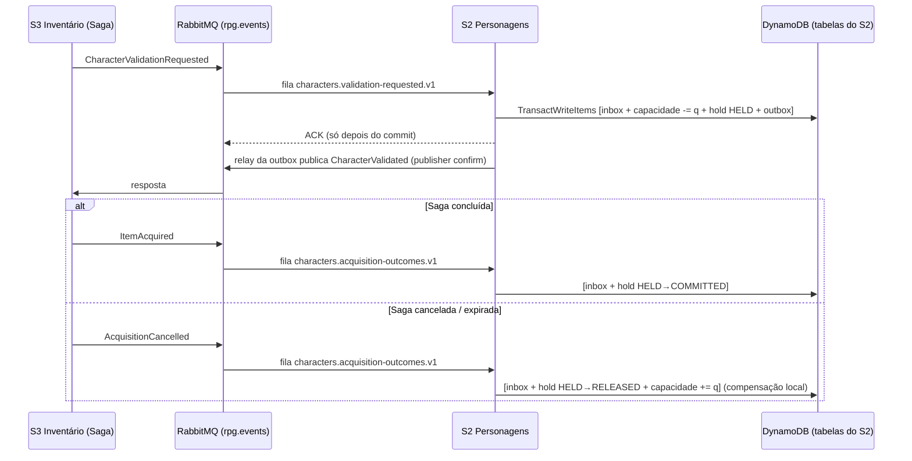
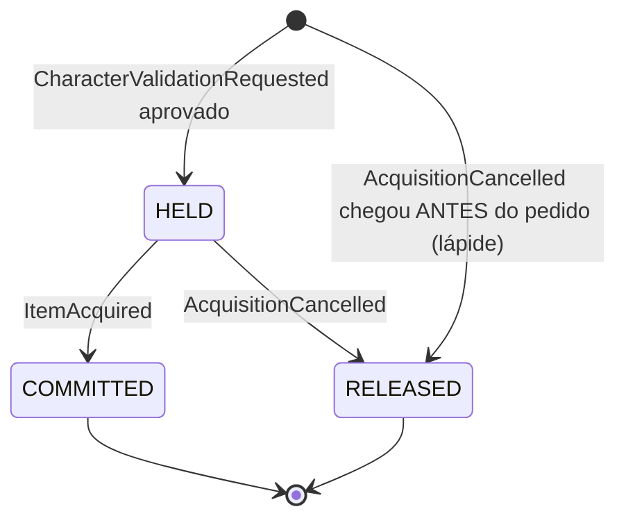

# S2 — Personagens (Python · FastAPI)

> RPG Nexus · Sistemas Distribuídos — FURB · Dono: **P2**

Microsserviço responsável pelas **fichas genéricas de personagem** e pela participação do
personagem na **Saga de aquisição de item**. Usa **DynamoDB** (tabelas exclusivas), **S3** (retratos)
e **RabbitMQ** (eventos).

---

## 1. Responsabilidades

| Faz | Não faz |
|---|---|
| CRUD de fichas com atributos/perícias livres (mapas) | Regras de sistemas comerciais (D&D, Tormenta) |
| Validar se o personagem pode receber um item (ativo, mesma campanha, capacidade) | Estoque, inventário e estado da Saga (são do S3 Inventário) |
| **Reservar capacidade** atomicamente e compensá-la quando a Saga é cancelada | Ler tabelas de outros serviços |
| Publicar `CharacterValidated` / `CharacterRejected` pela outbox | Chamadas HTTP síncronas para outros serviços |
| Retratos no S3 (URL pré-assinada ou upload pelo backend) | |
| Modelos de ficha privados, com versões, e fichas criadas a partir deles | Emitir login ou token (é do S4) |
| **Dinheiro**: saldo, débito e reembolso atômicos e idempotentes por eventos da compra | Preço, loja e estoque (são do S3) |
| Garantir que só o dono mexe na ficha e nos modelos dele | Decidir papéis na campanha (dono/jogador são do S1) |
| Guardar uma cópia de quem participa de cada campanha (eventos do S1) para autorizar | Ler o banco do S1 |

## 2. Participação na Saga

O S2 não apenas "responde sim/não": ele **reserva capacidade** do personagem (um *hold* por
`operationId`). Assim a regra `maxItems` continua correta mesmo com várias aquisições simultâneas
para o mesmo personagem — o S2 não precisa ler o inventário do S3.



### Máquina de estados da reserva (hold)



### Regras de validação

Ordem de avaliação (`app/domain/rules.py`):

1. Já existe hold para o `operationId`? `HELD`/`COMMITTED` → responde `CharacterValidated` de novo
   (*replay*, sem reservar outra vez); `RELEASED` → `OPERATION_CLOSED`.
2. `deadlineAt` (opcional) vencido → `DEADLINE_EXPIRED`.
3. Personagem inexistente → `CHARACTER_NOT_FOUND`; outra campanha → `CAMPAIGN_MISMATCH`;
   inativo → `CHARACTER_INACTIVE`; `slotsAvailable < quantity` → `CAPACITY_EXCEEDED`.

## 3. Garantias de consistência

| Requisito | Como o S2 atende | Onde |
|---|---|---|
| **R1 at-least-once / idempotência** | `messageId` gravado na inbox **na mesma transação** do efeito e do evento de saída. Duplicata → ACK sem reaplicar. Além disso, o hold tem chave por `operationId`, então até um reenvio com *outro* messageId não reserva duas vezes. | `handlers.py`, `dynamodb_store.py::_transact` |
| **Outbox transacional** | Evento de saída gravado no mesmo `TransactWriteItems`; relay publica com **publisher confirms** e só então marca `PUBLISHED`. Lease evita que réplicas publiquem o mesmo evento em paralelo. | `outbox_relay.py` |
| **R2 concorrência** | Escrita condicional `slotsAvailable >= :q` (+ `active`, `campaignId`). Se outra réplica vencer, a transação falha, o handler relê e decide de novo. Nunca há read-then-write ingênuo. | `_capacity_update` |
| **R4 consumidores concorrentes** | Réplicas do S2 consomem **as mesmas filas** (`prefetch` configurável). | `topology.py` |
| **R6 reconexão** | Laço supervisor com backoff exponencial + jitter; recria canais, re-declara topologia e consumidores. `/ready` e `/internal/messaging` mostram o estado. | `rabbitmq.py::run` |
| **Retry / DLQ (F4)** | Contador `x-retry-count` no header; fila `.retry` com TTL por mensagem (backoff 1 s, 2 s, 4 s…); após `MAX_RETRIES` vai para `.dlq` com `x-last-error`. | `retry.py`, `rabbitmq.py::_fail` |
| **Reordenação (F7)** | Cancelamento antes do pedido cria **lápide**; o pedido atrasado é recusado com `OPERATION_CLOSED` em vez de reter capacidade. Pedido após `deadlineAt` não reserva. | `handle_acquisition_cancelled` |
| **Banco por serviço** | Somente este serviço acessa `characters`, `character_inbox`, `character_outbox`. | `infra/manifests/characters.json` |

**Por que `slotsAvailable` é armazenado?** `ConditionExpression` do DynamoDB não faz aritmética entre
atributos. Guardar a capacidade livre permite a condição atômica `slotsAvailable >= :q`. Todas as
escritas mantêm a invariante `slotsAvailable = maxItems − slotsUsed ≥ 0`.

**Por que `version` não muda nas reservas?** `version` é a versão do *perfil* (edição pelo usuário,
`If-Match`). Se as reservas incrementassem a versão, editar o nome de um personagem durante uma
aquisição daria conflito falso. Ao reduzir `maxItems`, a condição `slotsAvailable >= −delta` protege a
capacidade.

## 4. Modelo de dados (DynamoDB)

| Tabela | Chave | Item | Observação |
|---|---|---|---|
| `characters` | `pk=CHAR#{id}`, `sk=PROFILE` | ficha + `maxItems`, `slotsUsed`, `slotsAvailable`, `version` | GSI esparso `byCampaign` (`gsi1pk=CAMPAIGN#{campaignId}`) |
| `characters` | `pk=CHAR#{id}`, `sk=HOLD#{operationId}` | reserva: `status`, `quantity`, `tombstone` | consultas por personagem com `begins_with` |
| `character_inbox` | `messageId` | `type`, `correlationId`, `outcome`, `detail` | TTL `expiresAt` (padrão 7 dias) |
| `character_read_model` | `campaignId` + `characterId` | resumo por personagem (vida, vagas, reservas por estado, `projectedAt`) | modelo de leitura (CQRS); reconstruível |
| `character_outbox` | `messageId` | `envelope`, `routingKey`, `status`, `attempts`, lease | GSI esparso `pending` só com itens pendentes |

S3: `s3://{S3_BUCKET}/characters/{characterId}/portrait`.

**Ficha livre (`sheet`).** A ficha pode ser organizada em até três colunas de blocos (atributos, perícias,
vida, mochila, texto, contador, rolagens, lista). O serviço valida formato e tamanho (até 60 blocos e
60 KB) e guarda a organização como texto JSON no item `PROFILE`; o conteúdo dos blocos é do frontend.

### Modelo de leitura separado (CQRS)

As consultas de campanha não leem a tabela de escrita. Elas leem `character_read_model`, uma tabela só de
consulta, com um resumo pronto por personagem.

| | Lado de escrita | Lado de leitura |
|---|---|---|
| Tabela | `characters` (fichas + reservas) | `character_read_model` |
| Chave | `pk=CHAR#{id}`, `sk=PROFILE` ou `HOLD#{op}` | `campaignId` + `characterId` |
| Otimizada para | transações e escritas condicionais da Saga | "painel da campanha" em uma Query pela chave primária |
| Conteúdo | estado normalizado, uma linha por reserva | resumo desnormalizado: vida, vagas, contagem de reservas por estado |
| Quem acessa | comandos (API de escrita e handlers da Saga) | `GET /campaigns/{campaignId}/roster` |

- **Projeção** (`app/application/read_model.py::Projector`): depois de cada escrita confirmada, relê a ficha e
  as reservas do personagem e regrava o resumo inteiro. Por reconstruir a partir da fonte, é idempotente e
  não depende da ordem dos eventos.
- **Gatilhos:** escritas pela API (`CharacterService`, via `on_change`) e mensagens da Saga
  (`Projector.after`, que envolve o `dispatch`, depois do efeito e antes do ACK).
- **Consistência eventual:** a leitura pode ficar um instante atrás da escrita; cada item traz `projectedAt`.
- **Queda entre gravar e projetar:** a mensagem é reentregue, a inbox impede o efeito duplicado e a projeção
  roda mesmo para a duplicata.
- **Corrida entre projeções:** a gravação é condicional (`projectedAt <= :novo`); uma projeção mais antiga
  nunca sobrescreve uma mais nova.
- **Falha no lado de leitura** não derruba a escrita: o erro é registrado (`read_model.projection_failed`) e
  o resumo é corrigido na próxima mudança ou pelo rebuild.
- **Rebuild:** `POST /internal/read-model/rebuild?campaignId=c1` reconstrói a campanha a partir do modelo de
  escrita. Use uma vez para personagens criados antes de o modelo de leitura existir.

Limitação: a projeção disparada pela API roda no próprio processo, logo após a escrita. Se o serviço cair
exatamente entre as duas, o resumo fica desatualizado até a próxima mudança daquele personagem ou até o rebuild.

Demonstração:

```bash
curl -s localhost:8000/campaigns/c1/roster                 # resumo + totais, lidos do modelo de leitura
docker compose exec characters python -m scripts.publish_event validation --character-id <id> --campaign-id c1
curl -s localhost:8000/campaigns/c1/roster                 # holds.held e slotsUsed do personagem mudaram
curl -s localhost:8000/internal/read-model                 # contadores do projetor
curl -s -X POST "localhost:8000/internal/read-model/rebuild?campaignId=c1"
aws --endpoint-url http://localhost:4566 dynamodb scan --table-name character_read_model   # a tabela separada
```

### Tracing distribuído (OpenTelemetry)

O S2 envia spans ao Jaeger da pilha (http://localhost:16686) e propaga o W3C `traceparent` nos **headers AMQP**:

- **Consumo:** o span `CONSUMER` é filho de quem publicou; o handler e as chamadas ao DynamoDB ficam dentro dele.
- **Outbox:** o evento de resposta é gravado com o `traceparent` do processamento (`OutboxRecord.trace_context`,
  atributo `traceContext` na tabela). O relay publica depois e reabre esse contexto, então o trace não se parte.
- **Retry:** a mensagem republicada para nova tentativa mantém os headers, e com eles o trace.
- **Logs:** cada linha de log tem `traceId`, o mesmo id do Jaeger.

Ligado por `TRACING_ENABLED=true` (padrão no Compose); com `false`, nenhum span é exportado. O item só vale com os
quatro serviços no mesmo trace.

### Login e dono da ficha

Toda rota de fichas, modelos e dinheiro exige o access token do S4 (`Authorization: Bearer ...`), validado
aqui com o mesmo segredo (`JWT_SECRET`), algoritmo (HS256), emissor (`iss`), audiência (`aud`) e validade
(`exp`). Ficam abertos só `/health`, `/ready`, `/internal/*` e o conteúdo do retrato (o `` do navegador
não manda token; o endereço só é conhecido por quem já leu a ficha).

| Quem | Pode |
|---|---|
| Participante da campanha (`OWNER` ou `PLAYER`) | criar ficha nela, ver o painel `/campaigns/{id}/roster` |
| Dono da ficha (`ownerId` = `sub` do token) | ler e **editar** a ficha, trocar o retrato |
| Mestre da campanha (`OWNER`) | **ler** todas as fichas da campanha (lista, ficha, reservas, extrato) |
| Quem não participa | nada na campanha: `403 NOT_CAMPAIGN_MEMBER` |

- O mestre não edita a ficha de um jogador (`403 NOT_OWNER`). O dono da ficha não muda
  por PATCH (`422 OWNER_IMMUTABLE`).
- Cada ficha volta com `access: {edit}`, calculado para quem perguntou; o front usa para mostrar ou
  travar as ações.
- **Fichas antigas**, criadas antes do login, não têm dono: só o mestre da campanha ainda as vê. Crie de novo.

#### Participantes das campanhas (cópia local dos eventos do S1)

O S2 não lê o banco do S1. Ele consome `CampaignMemberJoined` e `CampaignMemberRemoved` (fila
`characters.campaign-members.v1`) e guarda `CAMPAIGN#{id} / MEMBER#{userId}` com papel, se ainda participa e o
instante do evento. Evento mais antigo que o gravado é ignorado (`STALE`), então a ordem de chegada não importa;
a inbox barra o mesmo `messageId`.

- **Consistência eventual:** logo depois de criar ou entrar numa campanha, o S2 pode levar um instante para
  saber disso; a mensagem de `403` pede para tentar de novo.
- **Campanhas criadas antes desta mudança** não têm participantes no S2, porque os eventos delas já foram
  consumidos só pelo S3 e pelo S4. Crie a campanha de novo.
- `app/security.py` valida o token; o código foi conferido com um token emitido pelo próprio S4.

### Dinheiro (Saga de compra da loja)

O saldo (`currency.amount`) é do S2 e só muda por escrita condicional: nunca fica negativo, e duas compras ao
mesmo tempo não gastam o mesmo dinheiro (condição `currencyAmount >= preço` no `TransactWriteItems`).

| Evento recebido | O que o S2 faz | Resposta |
|---|---|---|
| `MoneyDebitRequested` | confere dono (`userId`), campanha, ficha ativa e saldo; debita e registra `MONEY#{operationId}` = `DEBITED` | `MoneyDebited` ou `MoneyDebitRejected` |
| `MoneyRefundRequested` | devolve o que foi debitado para a operação: `DEBITED` → `REFUNDED` | `MoneyRefunded` |

- **Idempotência dupla:** a inbox barra o mesmo `messageId`; o registro por `operationId` barra o mesmo pedido
  com outro `messageId` (responde `MoneyDebited` de novo sem cobrar; reembolso repetido não credita de novo).
- **Reordenação:** reembolso que chega antes do débito vira lápide (`REFUNDED`, `refundedAmount` 0), e o débito atrasado é
  recusado com `OPERATION_CLOSED`, como nas reservas de capacidade.
- **Sem ajuste manual:** depois de criada a ficha, o saldo só muda pelas compras na loja. `GET .../money/transactions`
  mostra os débitos e reembolsos (e ajustes manuais antigos, de quando essa rota existia).
- O PATCH da ficha muda só o nome da moeda: se mudasse o saldo, uma edição com a ficha antiga desfaria um débito
  feito nesse meio-tempo.

### Modelos de ficha (templates)

Modelo = estrutura da ficha + valores iniciais (atributos, perícias, vida máxima, mochila, moeda e saldo
inicial). Fica na tabela `character_templates`, privado de quem criou.

- **Sem dados pessoais:** ao salvar, o serviço esvazia anotações, listas e o cabeçalho, e volta contadores ao
  máximo. Rolagens ficam (são estrutura).
- **Versões:** cada `PATCH /templates/{id}` grava uma versão nova e imutável (`V#000002`), com `If-Match` para
  não sobrescrever outra edição (`412`). A versão atual fica no cabeçalho (`HEAD`).
- **Criar a partir do modelo:** `POST /characters/from-template/{id}` copia a versão (atual ou `version`
  pedida) e grava `sourceTemplate` na ficha. Editar o modelo depois **não** muda fichas existentes.
- **Apagar:** o modelo sai da lista e não cria fichas novas; as versões continuam gravadas.
- **Modelo da campanha:** quando o dono define um modelo na campanha (no S1), o S2 recebe
  `CampaignTemplateAssigned` (fila `characters.campaign-members.v1`) e guarda `CAMPAIGN#{id} / TEMPLATE` com o
  id e a versão, com a mesma regra de ordem dos participantes. Esse modelo, **só nessa versão**, fica liberado
  para os participantes da campanha: `GET /campaigns/{id}/template` e `POST /characters/from-template/{id}` com
  o `campaignId` dela. Fora da campanha, ou em outra versão, continua `404`.

## 5. Mensageria

| Direção | Evento | Routing key | Fila do S2 |
|---|---|---|---|
| consome | `CharacterValidationRequested` (`rpg.character.validation-requested.v1`) | `character.validation.requested.v1` | `characters.validation-requested.v1` |
| consome | `CharacterValidationRequested` **v2** (`rpg.character.validation-requested.v2`) | `character.validation.requested.v2` | `characters.validation-requested.v1` (a mesma) |
| consome | `ItemAcquired` (`rpg.item.acquired.v1`) | `item.acquired.v1` | `characters.acquisition-outcomes.v1` |
| consome | `AcquisitionCancelled` (`rpg.acquisition.cancelled.v1`) | `acquisition.cancelled.v1` | `characters.acquisition-outcomes.v1` |
| publica | `CharacterValidated` (`rpg.character.validated.v1`) | `character.validated.v1` | — |
| publica | `CharacterRejected` (`rpg.character.rejected.v1`) | `character.rejected.v1` | — |
| consome | `MoneyDebitRequested` (`rpg.money.debit-requested.v1`) | `money.debit.requested.v1` | `characters.money-commands.v1` |
| consome | `MoneyRefundRequested` (`rpg.money.refund-requested.v1`) | `money.refund.requested.v1` | `characters.money-commands.v1` |
| publica | `MoneyDebited` (`rpg.money.debited.v1`) | `money.debited.v1` | S3 em `inventory.saga-replies.v1` |
| publica | `MoneyDebitRejected` (`rpg.money.debit-rejected.v1`) | `money.debit-rejected.v1` | idem |
| publica | `MoneyRefunded` (`rpg.money.refunded.v1`) | `money.refunded.v1` | idem |
| consome | `CampaignMemberJoined` (`rpg.campaign.member.joined.v1`, do S1) | `campaign.member.joined.v1` | `characters.campaign-members.v1` |
| consome | `CampaignMemberRemoved` (`rpg.campaign.member.removed.v1`, do S1) | `campaign.member.removed.v1` | `characters.campaign-members.v1` |
| consome | `CampaignTemplateAssigned` (`rpg.campaign.template.assigned.v1`, do S1) | `campaign.template.assigned.v1` | `characters.campaign-members.v1` |

Os nomes das quatro filas de consumo vêm do ambiente (`RABBITMQ_QUEUE_VALIDATION`,
`RABBITMQ_QUEUE_ACQUISITION_OUTCOMES`, `RABBITMQ_QUEUE_MONEY`, `RABBITMQ_QUEUE_CAMPAIGN_MEMBERS`), com os
nomes da tabela acima como padrão; `.retry` e `.dlq` seguem o nome de cada uma.

Cada fila tem `.retry` e `.dlq`. Schemas: `contracts/events/character-*.schema.json`, com exemplos
válidos e inválidos em `contracts/examples/`. Todo evento produzido é validado contra o schema antes de
entrar na outbox (`VALIDATE_OUTGOING_EVENTS=true`).

### Versionamento de eventos: v1 e v2 convivendo

`CharacterValidationRequested` existe em duas versões ao mesmo tempo, e o S2 consome as duas:

| | v1 | v2 |
|---|---|---|
| `type` / `version` | `rpg.character.validation-requested.v1` / `1` | `rpg.character.validation-requested.v2` / `2` |
| Routing key | `character.validation.requested.v1` | `character.validation.requested.v2` |
| Prazo da Saga | `deadlineAt`, opcional | `expiresAt`, **obrigatório** |
| Schema | `character-validation-requested.v1.schema.json` | `character-validation-requested.v2.schema.json` |

- **Por que é uma versão nova e não um campo a mais:** tornar o prazo obrigatório e renomeá-lo quebra quem
  publica a v1. Mudança incompatível pede `version` nova (regra de `contracts/README.md`).
- **Como convivem:** cada versão tem `type`, routing key e schema próprios. A fila do S2 está ligada às duas
  routing keys; `MessageHandlers.dispatch` escolhe o handler pelo par `type`/`version`.
- **Onde a diferença morre:** `ValidationRequestedPayloadV2.upcast()` (`app/messaging/events.py`) converte a
  v2 para a forma interna. Regras, reserva, inbox e outbox são as mesmas; o domínio não conhece versões.
- **Quem publica a v1 não muda nada:** produtores antigos continuam funcionando, e a resposta
  (`CharacterValidated` / `CharacterRejected` v1) é a mesma para as duas versões.
- **Idempotência entre versões:** a mesma `operationId` pedida em v1 e depois em v2 reserva uma única vez.
- **Versão desconhecida** (ex.: v3) continua sendo mensagem venenosa e vai para a DLQ.

Demonstração (com a pilha no ar, na raiz do monorepo):

```bash
docker compose exec characters python -m scripts.publish_event validation --character-id <id> --campaign-id c1
docker compose exec characters python -m scripts.publish_event validation --character-id <id> --campaign-id c1 --event-version 2
curl -s localhost:8000/characters/<id>/holds            # duas reservas HELD, uma por operação
curl -s localhost:8000/internal/inbox/<messageId>       # o campo "type" mostra a versão recebida
docker compose logs characters | grep validation.decided # cada linha traz "eventVersion": 1 ou 2
```

O `smoke_s2` também publica um pedido v2 e confere validação, reserva e compensação.

## 6. API HTTP

Documentação interativa: `http://localhost:8000/docs`.

| Método | Rota | Descrição |
|---|---|---|
| GET | `/health` | liveness |
| GET | `/ready` | DynamoDB, S3 e RabbitMQ; `503` se algum estiver fora |
| POST | `/characters` | cria ficha; `Idempotency-Key` opcional (repetição → `200` com a mesma ficha) |
| GET | `/characters?campaignId=c1&limit=50&cursor=` | lista por campanha (paginada) |
| GET | `/characters/{id}` | consulta; header `ETag` = versão |
| PATCH | `/characters/{id}` | JSON Merge Patch (`null` remove atributo/perícia); `If-Match` → `412` se desatualizado. O campo `sheet` (organização livre da ficha em blocos) é substituído por inteiro; `null` volta à ficha padrão |
| POST | `/characters/from-template/{templateId}` | cria ficha copiando o modelo (`version` opcional); grava `sourceTemplate`. Vale também o modelo definido na campanha do `campaignId`, na versão dela |
| GET | `/characters/{id}/money/transactions` | débitos e reembolsos da ficha |
| POST | `/templates` | salva modelo privado (v1) |
| GET | `/templates` | meus modelos |
| GET | `/templates/{id}?version=` | modelo (versão atual ou pedida) |
| PATCH | `/templates/{id}` | grava versão nova; `If-Match` → `412` se desatualizado |
| DELETE | `/templates/{id}` | tira da lista; fichas já criadas não mudam |
| GET | `/campaigns/{campaignId}/template` | modelo definido na campanha, na versão dela (só participantes; `404` se não há) |
| GET | `/campaigns/{campaignId}/roster` | **consulta (CQRS)**: resumo de cada personagem e totais da campanha, lidos do modelo de leitura |
| GET | `/characters/{id}/holds` | reservas da Saga (evidência na defesa) |
| POST | `/characters/{id}/portrait-upload` | URL pré-assinada `PUT` para o S3 |
| POST | `/characters/{id}/portrait/confirm` | S2 confere tamanho, tipo e *magic bytes* e grava a referência |
| PUT | `/characters/{id}/portrait` | upload pelo backend (fallback quando a URL do emulador não é acessível) |
| GET | `/characters/{id}/portrait` | URL pré-assinada de leitura (`?redirect=true` redireciona) |
| GET | `/characters/{id}/portrait/content` | bytes do retrato via backend |
| GET | `/internal/outbox` | pendentes na outbox (F6) |
| GET | `/internal/inbox/{messageId}` | registro de processamento (F2/F3) |
| POST | `/internal/read-model/rebuild?campaignId=` | reconstrói o modelo de leitura da campanha |
| GET | `/internal/read-model` | contadores do projetor |
| GET | `/internal/messaging` | conexão, reconexões, retries, DLQ, desfechos |

Rotas de fichas, modelos e dinheiro exigem `Authorization: Bearer <access token do S4>`.
Erros sempre no formato `{"error": {"code", "message", "details"}}`.

```bash
curl -s -X POST localhost:8000/characters -H 'Content-Type: application/json' -d '{
  "campaignId": "c1", "name": "Lyra Ventobravo",
  "attributes": {"forca": 15, "destreza": 12}, "skills": {"furtividade": 3},
  "hp": {"current": 22, "max": 22}, "maxItems": 10 }'
```

## 7. Como rodar

O serviço é declarado no `docker-compose.yml` da **raiz do monorepo**, junto com RabbitMQ e
MiniStack (não há compose próprio do S2). Na raiz:

```bash
cp .env.example .env
docker compose up --build characters      # sobe só o S2 e o que ele precisa (RabbitMQ, MiniStack, Terraform)
# em outro terminal: prova o S2 fazendo o papel do S3 Inventário
docker compose exec characters python -m scripts.smoke_s2 --poison
```

As tabelas DynamoDB, o bucket e o CORS são criados pelo Terraform (`infra/terraform/characters.tf`),
espelhando `infra/manifests/characters.json`. O script `scripts.create_resources` cria o mesmo a partir
do manifesto, para usar sem o Terraform. O build usa a raiz como contexto, para copiar `contracts/` e o
manifesto.

Endpoints e credenciais de AWS/MiniStack, bucket (`RPG_ASSETS_BUCKET`), usuário do RabbitMQ e origem do
CORS vêm do `.env` da raiz; `services/characters/.env.example` guarda só as variáveis próprias do S2.

Sem Docker nem AWS (útil para o frontend): `STORE_BACKEND=memory STORAGE_BACKEND=memory MESSAGING_ENABLED=false uvicorn --factory app.main:create_app --port 8000`.

`characters-worker` é o mesmo serviço sem porta publicada no host: são as réplicas que consomem as filas
e podem ser escaladas (`characters` fica com a API na porta 8000 e também consome).

Itens de bônus do trabalho, cada um com seu roteiro de demonstração:

| Bônus | Onde | Como ligar |
|---|---|---|
| Versionamento de eventos | seção 5 deste README | já ativo |
| Modelo de leitura separado (CQRS) | seção 4 deste README | já ativo |
| Autoescala pelo tamanho da fila | `infra/autoscaler/README.md` | `docker compose --profile autoscale up -d` |
| Tracing distribuído (OpenTelemetry + Jaeger) | seção 4 deste README | já ativo; UI em http://localhost:16686 |
| Infraestrutura como código (Terraform) | `infra/terraform/README.md` | já ativo: o `docker compose up` roda o Terraform |

### Testes

```bash
pip install -r requirements-dev.txt
pytest            # unidade, contrato, API (TestClient), DynamoDB (moto e validação de parâmetros botocore)
```

## 8. Roteiro de falhas que envolvem o S2

| Cenário | Como provocar | O que mostrar |
|---|---|---|
| **F1 compensação** | `publish_event cancelled --operation-id <op>` (ou fluxo real com `SIMULATED_FAILURE_RATE=1` no S4) | `/characters/{id}` capacidade devolvida; `/holds` → `RELEASED` |
| **F2 crash antes do ACK** | `FAULT_CRASH_BEFORE_ACK=once docker compose up -d characters` e publicar uma validação | log `fault.crash_before_ack`; contêiner reinicia; reentrega aparece como `DUPLICATE`; `/holds` com um único hold |
| **F3 duplicação** | `publish_event validation ... --times 5` | um evento de resposta; `/internal/inbox/{messageId}`; capacidade −1 só uma vez |
| **F4 poison** | `publish_event poison --kind json` | logs `message.retry_scheduled` 1/3, 2/3, 3/3 → `message.dead_lettered`; fila `.dlq` no painel (15672); mensagens seguintes processadas normalmente |
| **F6 broker fora** | `docker compose stop rabbitmq` por 30 s, gerar validações, `start` | `/ready` → `degraded`; `/internal/outbox.pending` cresce e volta a 0; `/internal/messaging.reconnects` |
| **F7 resposta tardia** | `publish_event cancelled` e depois `validation` com o mesmo `--operation-id` | `CharacterRejected` `OPERATION_CLOSED`; nenhuma capacidade retida |
| **F8 escala** | `docker compose up -d --scale characters-worker=3` (ou o autoscaler: `infra/autoscaler/README.md`) | logs com `instance` diferentes; capacidade nunca negativa |

Filtrar a história de uma operação: `docker compose logs characters | grep <operationId>` (todo log
carrega `correlationId`).

## 9. Estrutura

```text
app/
├── domain/          regras puras (modelos, decisões, erros) — sem I/O
├── application/     casos de uso + portas (Protocol) + DTOs
├── adapters/        DynamoDB, S3, implementações em memória
├── messaging/       envelope, eventos, contratos, retry, topologia, RabbitMQ, relay da outbox
├── api/             rotas FastAPI e formato de erro
├── bootstrap.py     composição dos adaptadores conforme o ambiente
└── main.py          create_app() + ciclo de vida (consumidor e relay)
scripts/             provisionamento, publicação de eventos, observação e smoke test
tests/               unidade, contrato, adaptadores e API
contracts-consumed/  expectativas do S2 sobre eventos de P3 (consumer-driven contracts)
```

## 10. Decisões a combinar com o grupo

1. **S2 consome `ItemAcquired` e `AcquisitionCancelled`** (filas próprias). Com isso `ItemAcquired`
   passa a ter 3 consumidores (S1, S4 e S2). Os payloads precisam conter `operationId` e
   `characterId` — verificado por `tests/test_contracts.py` assim que P3 publicar os schemas.
2. **P3 deve sempre publicar `AcquisitionCancelled`** quando uma Saga que pediu validação terminar sem
   sucesso (inclusive por expiração); é isso que devolve a capacidade.
3. `deadlineAt` em `CharacterValidationRequested` é **opcional**, mas recomendado.
4. Nomes de `type`/routing key seguem o padrão do plano (`rpg.<dominio>.<evento>.v1`).
5. **Compra na loja (P3):** o contrato de dinheiro é o do S3 (`contracts/events/money-*.v1`, copiados sem
   alteração da branch do P3). Toda resposta repete `operationId`, `campaignId`, `userId`, `characterId`, `itemId` e
   `amount` (= preço), que o S3 confere; o S2 acrescenta `balance` e, no reembolso, `refundedAmount` (0 quando não
   havia débito). Item de preço 0 é aceito.

## 11. Limitações conhecidas

- Um hold `COMMITTED` ocupa a vaga para sempre: o MVP não tem remoção de itens do inventário. Se
  isso entrar, o S3 deve publicar um evento (ex.: `ItemRemoved`) para o S2 liberar a vaga.
- `slotsRemaining` em `CharacterValidated` é informativo (valor no momento da decisão).
- A fila `.retry` usa TTL por mensagem: o RabbitMQ só expira mensagens na cabeça da fila, então uma
  mensagem com backoff menor pode esperar a da frente. Aceitável para o volume da demonstração.
- Publicação duplicada é possível se o processo cair entre o *confirm* do broker e o `PUBLISHED`
  (entrega *at-least-once*); os consumidores deduplicam por `messageId`.
- O S2 ainda não consome `CampaignTemplateAssigned` (o S1 não publica esse evento).
