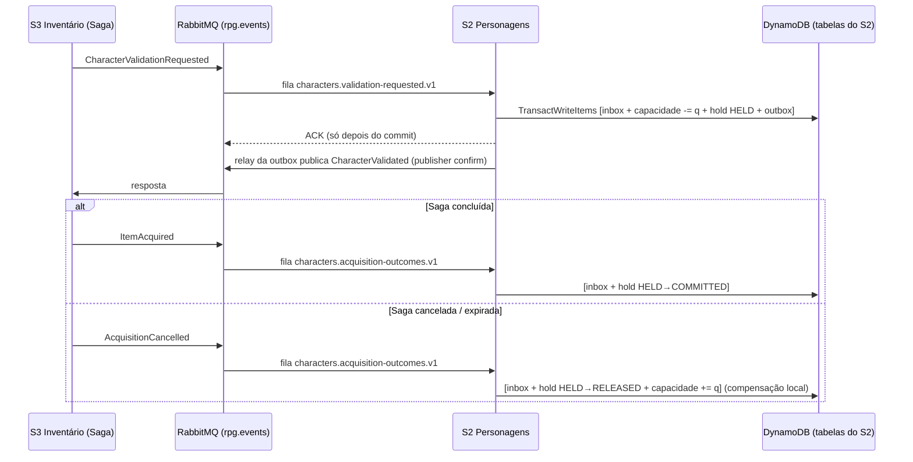
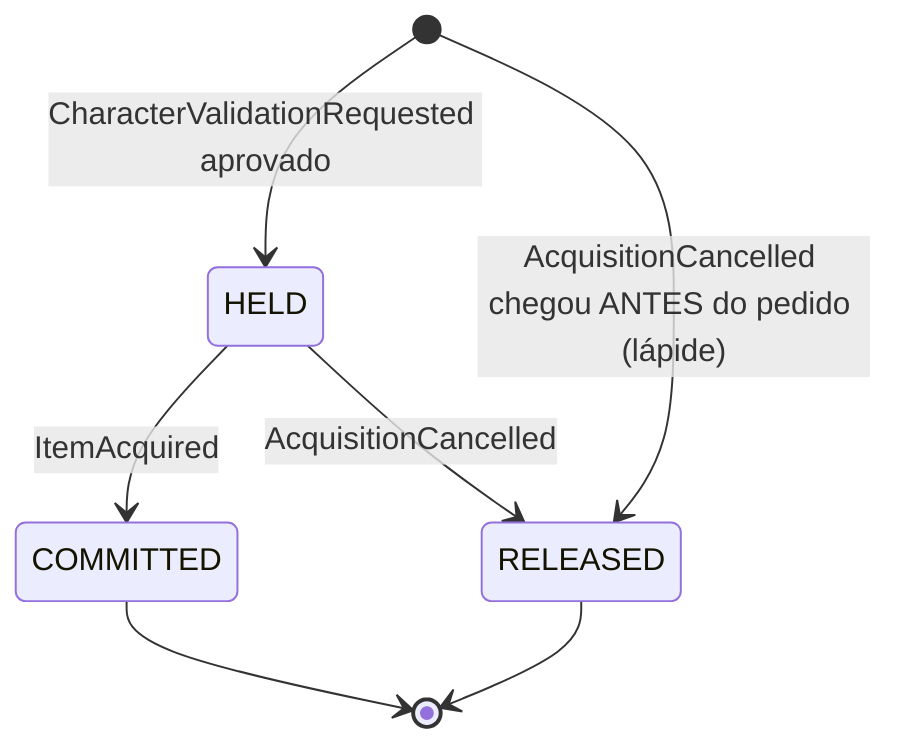

# S2 — Personagens (Python · FastAPI)

> RPG Nexus · Sistemas Distribuídos — FURB · Dono: **P2**

Microsserviço responsável pelas **fichas genéricas de personagem** e pela participação do
personagem na **Saga de aquisição de item**. Usa **DynamoDB** (tabelas exclusivas), **S3** (retratos)
e **RabbitMQ** (eventos).

---

## 1. Responsabilidades

| Faz | Não faz |
|---|---|
| CRUD de fichas com atributos/perícias livres (mapas) | Regras de sistemas comerciais (D&D, Tormenta) |
| Validar se o personagem pode receber um item (ativo, mesma campanha, capacidade) | Estoque, inventário e estado da Saga (são do S3 Inventário) |
| **Reservar capacidade** atomicamente e compensá-la quando a Saga é cancelada | Ler tabelas de outros serviços |
| Publicar `CharacterValidated` / `CharacterRejected` pela outbox | Chamadas HTTP síncronas para outros serviços |
| Retratos no S3 (URL pré-assinada ou upload pelo backend) | |

## 2. Participação na Saga

O S2 não apenas "responde sim/não": ele **reserva capacidade** do personagem (um *hold* por
`operationId`). Assim a regra `maxItems` continua correta mesmo com várias aquisições simultâneas
para o mesmo personagem — o S2 não precisa ler o inventário do S3.



### Máquina de estados da reserva (hold)



### Regras de validação

Ordem de avaliação (`app/domain/rules.py`):

1. Já existe hold para o `operationId`? `HELD`/`COMMITTED` → responde `CharacterValidated` de novo
   (*replay*, sem reservar outra vez); `RELEASED` → `OPERATION_CLOSED`.
2. `deadlineAt` (opcional) vencido → `DEADLINE_EXPIRED`.
3. Personagem inexistente → `CHARACTER_NOT_FOUND`; outra campanha → `CAMPAIGN_MISMATCH`;
   inativo → `CHARACTER_INACTIVE`; `slotsAvailable < quantity` → `CAPACITY_EXCEEDED`.

## 3. Garantias de consistência

| Requisito | Como o S2 atende | Onde |
|---|---|---|
| **R1 at-least-once / idempotência** | `messageId` gravado na inbox **na mesma transação** do efeito e do evento de saída. Duplicata → ACK sem reaplicar. Além disso, o hold tem chave por `operationId`, então até um reenvio com *outro* messageId não reserva duas vezes. | `handlers.py`, `dynamodb_store.py::_transact` |
| **Outbox transacional** | Evento de saída gravado no mesmo `TransactWriteItems`; relay publica com **publisher confirms** e só então marca `PUBLISHED`. Lease evita que réplicas publiquem o mesmo evento em paralelo. | `outbox_relay.py` |
| **R2 concorrência** | Escrita condicional `slotsAvailable >= :q` (+ `active`, `campaignId`). Se outra réplica vencer, a transação falha, o handler relê e decide de novo. Nunca há read-then-write ingênuo. | `_capacity_update` |
| **R4 consumidores concorrentes** | Réplicas do S2 consomem **as mesmas filas** (`prefetch` configurável). | `topology.py` |
| **R6 reconexão** | Laço supervisor com backoff exponencial + jitter; recria canais, re-declara topologia e consumidores. `/ready` e `/internal/messaging` mostram o estado. | `rabbitmq.py::run` |
| **Retry / DLQ (F4)** | Contador `x-retry-count` no header; fila `.retry` com TTL por mensagem (backoff 1 s, 2 s, 4 s…); após `MAX_RETRIES` vai para `.dlq` com `x-last-error`. | `retry.py`, `rabbitmq.py::_fail` |
| **Reordenação (F7)** | Cancelamento antes do pedido cria **lápide**; o pedido atrasado é recusado com `OPERATION_CLOSED` em vez de reter capacidade. Pedido após `deadlineAt` não reserva. | `handle_acquisition_cancelled` |
| **Banco por serviço** | Somente este serviço acessa `characters`, `character_inbox`, `character_outbox`. | `infra/manifests/characters.json` |

**Por que `slotsAvailable` é armazenado?** `ConditionExpression` do DynamoDB não faz aritmética entre
atributos. Guardar a capacidade livre permite a condição atômica `slotsAvailable >= :q`. Todas as
escritas mantêm a invariante `slotsAvailable = maxItems − slotsUsed ≥ 0`.

**Por que `version` não muda nas reservas?** `version` é a versão do *perfil* (edição pelo usuário,
`If-Match`). Se as reservas incrementassem a versão, editar o nome de um personagem durante uma
aquisição daria conflito falso. Ao reduzir `maxItems`, a condição `slotsAvailable >= −delta` protege a
capacidade.

## 4. Modelo de dados (DynamoDB)

| Tabela | Chave | Item | Observação |
|---|---|---|---|
| `characters` | `pk=CHAR#{id}`, `sk=PROFILE` | ficha + `maxItems`, `slotsUsed`, `slotsAvailable`, `version` | GSI esparso `byCampaign` (`gsi1pk=CAMPAIGN#{campaignId}`) |
| `characters` | `pk=CHAR#{id}`, `sk=HOLD#{operationId}` | reserva: `status`, `quantity`, `tombstone` | consultas por personagem com `begins_with` |
| `character_inbox` | `messageId` | `type`, `correlationId`, `outcome`, `detail` | TTL `expiresAt` (padrão 7 dias) |
| `character_outbox` | `messageId` | `envelope`, `routingKey`, `status`, `attempts`, lease | GSI esparso `pending` só com itens pendentes |

S3: `s3://{S3_BUCKET}/characters/{characterId}/portrait`.

**Ficha livre (`sheet`).** A ficha pode ser organizada em até três colunas de blocos (atributos, perícias,
vida, mochila, texto, contador, rolagens, lista). O serviço valida formato e tamanho (até 60 blocos e
60 KB) e guarda a organização como texto JSON no item `PROFILE`; o conteúdo dos blocos é do frontend.

## 5. Mensageria

| Direção | Evento | Routing key | Fila do S2 |
|---|---|---|---|
| consome | `CharacterValidationRequested` (`rpg.character.validation-requested.v1`) | `character.validation.requested.v1` | `characters.validation-requested.v1` |
| consome | `ItemAcquired` (`rpg.item.acquired.v1`) | `item.acquired.v1` | `characters.acquisition-outcomes.v1` |
| consome | `AcquisitionCancelled` (`rpg.acquisition.cancelled.v1`) | `acquisition.cancelled.v1` | `characters.acquisition-outcomes.v1` |
| publica | `CharacterValidated` (`rpg.character.validated.v1`) | `character.validated.v1` | — |
| publica | `CharacterRejected` (`rpg.character.rejected.v1`) | `character.rejected.v1` | — |

Cada fila tem `.retry` e `.dlq`. Schemas: `contracts/events/character-*.v1.schema.json`, com exemplos
válidos e inválidos em `contracts/examples/`. Todo evento produzido é validado contra o schema antes de
entrar na outbox (`VALIDATE_OUTGOING_EVENTS=true`).

## 6. API HTTP

Documentação interativa: `http://localhost:8000/docs`.

| Método | Rota | Descrição |
|---|---|---|
| GET | `/health` | liveness |
| GET | `/ready` | DynamoDB, S3 e RabbitMQ; `503` se algum estiver fora |
| POST | `/characters` | cria ficha; `Idempotency-Key` opcional (repetição → `200` com a mesma ficha) |
| GET | `/characters?campaignId=c1&limit=50&cursor=` | lista por campanha (paginada) |
| GET | `/characters/{id}` | consulta; header `ETag` = versão |
| PATCH | `/characters/{id}` | JSON Merge Patch (`null` remove atributo/perícia); `If-Match` → `412` se desatualizado. O campo `sheet` (organização livre da ficha em blocos) é substituído por inteiro; `null` volta à ficha padrão |
| GET | `/characters/{id}/holds` | reservas da Saga (evidência na defesa) |
| POST | `/characters/{id}/portrait-upload` | URL pré-assinada `PUT` para o S3 |
| POST | `/characters/{id}/portrait/confirm` | S2 confere tamanho, tipo e *magic bytes* e grava a referência |
| PUT | `/characters/{id}/portrait` | upload pelo backend (fallback quando a URL do emulador não é acessível) |
| GET | `/characters/{id}/portrait` | URL pré-assinada de leitura (`?redirect=true` redireciona) |
| GET | `/characters/{id}/portrait/content` | bytes do retrato via backend |
| GET | `/internal/outbox` | pendentes na outbox (F6) |
| GET | `/internal/inbox/{messageId}` | registro de processamento (F2/F3) |
| GET | `/internal/messaging` | conexão, reconexões, retries, DLQ, desfechos |

Erros sempre no formato `{"error": {"code", "message", "details"}}`.

```bash
curl -s -X POST localhost:8000/characters -H 'Content-Type: application/json' -d '{
  "campaignId": "c1", "name": "Lyra Ventobravo",
  "attributes": {"forca": 15, "destreza": 12}, "skills": {"furtividade": 3},
  "hp": {"current": 22, "max": 22}, "maxItems": 10 }'
```

## 7. Como rodar

O serviço é declarado no `docker-compose.yml` da **raiz do monorepo**, junto com RabbitMQ e
MiniStack (não há compose próprio do S2). Na raiz:

```bash
cp .env.example .env
docker compose up --build characters      # sobe só o S2 e o que ele precisa (RabbitMQ, MiniStack, inits)
# em outro terminal: prova o S2 fazendo o papel do S3 Inventário
docker compose exec characters python -m scripts.smoke_s2 --poison
```

`characters-init` cria as tabelas DynamoDB e aplica o CORS do bucket a partir de
`infra/manifests/characters.json` (tabelas, índices, TTL, CORS, filas e bindings). O build usa a raiz
como contexto, para copiar `contracts/` e o manifesto.

Endpoints e credenciais de AWS/MiniStack, bucket (`RPG_ASSETS_BUCKET`), usuário do RabbitMQ e origem do
CORS vêm do `.env` da raiz; `services/characters/.env.example` guarda só as variáveis próprias do S2.

Sem Docker nem AWS (útil para o frontend): `STORE_BACKEND=memory STORAGE_BACKEND=memory MESSAGING_ENABLED=false uvicorn --factory app.main:create_app --port 8000`.

### Testes

```bash
pip install -r requirements-dev.txt
pytest            # unidade, contrato, API (TestClient), DynamoDB (moto e validação de parâmetros botocore)
```

## 8. Roteiro de falhas que envolvem o S2

| Cenário | Como provocar | O que mostrar |
|---|---|---|
| **F1 compensação** | `publish_event cancelled --operation-id <op>` (ou fluxo real com `SIMULATED_FAILURE_RATE=1` no S4) | `/characters/{id}` capacidade devolvida; `/holds` → `RELEASED` |
| **F2 crash antes do ACK** | `FAULT_CRASH_BEFORE_ACK=once docker compose up -d characters` e publicar uma validação | log `fault.crash_before_ack`; contêiner reinicia; reentrega aparece como `DUPLICATE`; `/holds` com um único hold |
| **F3 duplicação** | `publish_event validation ... --times 5` | um evento de resposta; `/internal/inbox/{messageId}`; capacidade −1 só uma vez |
| **F4 poison** | `publish_event poison --kind json` | logs `message.retry_scheduled` 1/3, 2/3, 3/3 → `message.dead_lettered`; fila `.dlq` no painel (15672); mensagens seguintes processadas normalmente |
| **F6 broker fora** | `docker compose stop rabbitmq` por 30 s, gerar validações, `start` | `/ready` → `degraded`; `/internal/outbox.pending` cresce e volta a 0; `/internal/messaging.reconnects` |
| **F7 resposta tardia** | `publish_event cancelled` e depois `validation` com o mesmo `--operation-id` | `CharacterRejected` `OPERATION_CLOSED`; nenhuma capacidade retida |
| **F8 escala** | `docker compose up -d --scale characters=3` | logs com `instance` diferentes; capacidade nunca negativa |

Filtrar a história de uma operação: `docker compose logs characters | grep <operationId>` (todo log
carrega `correlationId`).

## 9. Estrutura

```text
app/
├── domain/          regras puras (modelos, decisões, erros) — sem I/O
├── application/     casos de uso + portas (Protocol) + DTOs
├── adapters/        DynamoDB, S3, implementações em memória
├── messaging/       envelope, eventos, contratos, retry, topologia, RabbitMQ, relay da outbox
├── api/             rotas FastAPI e formato de erro
├── bootstrap.py     composição dos adaptadores conforme o ambiente
└── main.py          create_app() + ciclo de vida (consumidor e relay)
scripts/             provisionamento, publicação de eventos, observação e smoke test
tests/               unidade, contrato, adaptadores e API
contracts-consumed/  expectativas do S2 sobre eventos de P3 (consumer-driven contracts)
```

## 10. Decisões a combinar com o grupo

1. **S2 consome `ItemAcquired` e `AcquisitionCancelled`** (filas próprias). Com isso `ItemAcquired`
   passa a ter 3 consumidores (S1, S4 e S2). Os payloads precisam conter `operationId` e
   `characterId` — verificado por `tests/test_contracts.py` assim que P3 publicar os schemas.
2. **P3 deve sempre publicar `AcquisitionCancelled`** quando uma Saga que pediu validação terminar sem
   sucesso (inclusive por expiração); é isso que devolve a capacidade.
3. `deadlineAt` em `CharacterValidationRequested` é **opcional**, mas recomendado.
4. Nomes de `type`/routing key seguem o padrão do plano (`rpg.<dominio>.<evento>.v1`).

## 11. Limitações conhecidas

- Um hold `COMMITTED` ocupa a vaga para sempre: o MVP não tem remoção de itens do inventário. Se
  isso entrar, o S3 deve publicar um evento (ex.: `ItemRemoved`) para o S2 liberar a vaga.
- `slotsRemaining` em `CharacterValidated` é informativo (valor no momento da decisão).
- A fila `.retry` usa TTL por mensagem: o RabbitMQ só expira mensagens na cabeça da fila, então uma
  mensagem com backoff menor pode esperar a da frente. Aceitável para o volume da demonstração.
- Publicação duplicada é possível se o processo cair entre o *confirm* do broker e o `PUBLISHED`
  (entrega *at-least-once*); os consumidores deduplicam por `messageId`.
